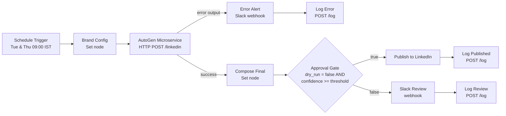

# FinEdge LinkedIn Content Automation — n8n + AutoGen Microservice

An n8n workflow that, on a schedule, asks a multi-agent AutoGen microservice for LinkedIn post ideas, a draft, a confidence score and hashtags, then routes the post through an approval gate: to **Slack for human review** (dry-run or low confidence) or **directly to LinkedIn** (live mode and confidence at or above threshold). Every run is logged to a CSV file for monitoring and threshold tuning.

Built as a course-end project for the **Post Graduate Program in Applied Agentic AI** (Virginia Tech and Simplilearn). FinEdge is the fictional fintech company from the project brief.

**Status:** built and tested end to end on the course Ubuntu VM. See section 6 for the test results and the [`screenshots/`](screenshots/) folder for evidence.

## 1. Architecture



**Inside the microservice** (`main.py`, FastAPI), four AutoGen `AssistantAgent`s run in sequence. This is the same orchestrator pattern as Lesson 02 Demo 01 (CodeGen → Tester → Debugger), applied to content:

| Step | Agent | Output |
|---|---|---|
| 1 | Ideator | N post ideas tied to brand pillars and the topic |
| 2 | Writer | One full draft for the strongest idea |
| 3 | Reviewer | Rubric score 0.0–1.0 (voice, clarity, factual caution, relevance, hook) |
| 4 | Hashtagger | 3–5 hashtags |
| 5 | Guardrails (code, not LLM) | Penalties for banned terms, risky financial claims ("guaranteed returns", "risk-free" and similar), length, missing hashtags |

`confidence = reviewer score − guardrail penalties`, clamped to 0–1. The response also includes the breakdown, so a human reviewer can see *why* a score is low.

**Logging (two levels)**
- `logs/runs.jsonl` is written by the service. It records every agent reply, request and result (audit trail).
- `logs/run_log.csv` is written via `POST /log` by n8n at the end of every branch. It records timestamp, run id, route, status, confidence, threshold, dry-run flag, mode, topic, hashtags, draft preview and error. It opens directly in Excel or Google Sheets.

## 2. Project structure

```
linkedin-autogen/
├── main.py                              # FastAPI + AutoGen microservice
├── .env.example                         # configuration template (copy to .env)
├── requirements.txt
├── n8n/finedge_linkedin_workflow.json   # import into n8n
├── tests/
│   ├── test_curl.sh                     # live smoke tests (service running)
│   ├── sample_request.json
│   └── test_offline.py                  # logic checks, no packages or keys needed
├── screenshots/                         # evidence from the test runs (see section 6)
├── README.md
└── REFLECTION.md                        # design decisions, challenges and trade-offs
```

## 3. Setup on the Ubuntu VM

Three terminal tabs are used (Konsole: **Ctrl+Shift+T** opens a new tab):

| Tab | Runs | Notes |
|---|---|---|
| 1 | `uvicorn` (microservice) | Leave running |
| 2 | `bash` (tests, `curl`) | Free for commands |
| 3 | `n8n` | Leave running |

Every new tab starts in the home folder with the venv switched off, so run `cd ~/linkedin-autogen` (and `source venv/bin/activate` for Python commands) first.

### 3.1 Microservice (tab 1)

```bash
cd ~/linkedin-autogen
python3 -m venv venv
source venv/bin/activate          # prompt now starts with (venv)
pip install -r requirements.txt
cp .env.example .env
sed -i 's/MOCK_MODE=false/MOCK_MODE=true/' .env   # sample output first, no Azure calls
uvicorn main:app --host 0.0.0.0 --port 8000
```

When mock mode works, edit `.env`: set `AZURE_OPENAI_API_KEY` to your Azure OpenAI key, set `MOCK_MODE=false`, then restart uvicorn (Ctrl+C, then run the same command again).

> **Key safety:** put the key only in `.env`, never in `main.py`, the workflow JSON, screenshots or the submission. Submit `.env.example`, not `.env`.

### 3.2 n8n (tab 3)

According to the n8n installation docs, n8n needs **Node.js 20.19 to 24.x**. The lab VM had Node.js v20.20.2 and no n8n, so n8n was run without a global install:

```bash
node -v        # must be v20.19 or newer (up to v24.x)
npx n8n        # answer "y" the first time; editor at http://localhost:5678
```

The tested version was **n8n 2.8.4**. On first start, n8n asks you to create a local owner account. The message `Failed to start Python task runner` is harmless: this workflow uses no Python Code nodes.

### 3.3 Import and configure the workflow

1. In n8n, create a new workflow (**Start from scratch**), then use the **⋯** menu at the top right → **Import from File…** → `n8n/finedge_linkedin_workflow.json`.
2. Open **Brand Config** (make sure the **Editor** tab is selected, since past executions are read-only) and set:
   - `service_url`: `http://127.0.0.1:8000`. Use the numeric address, not `localhost` (see section 7).
   - `slack_webhook_url`: your Slack incoming-webhook URL
   - `confidence_threshold`: start at `0.75`
   - `dry_run`: keep `true` until you have reviewed several drafts
   - `linkedin_org_urn`: only needed for live posting
3. **Publish to LinkedIn** shows a red warning until a LinkedIn credential is selected. This is only needed for live mode. Posting as an organization page typically requires LinkedIn's Community Management API access; check current requirements in the n8n LinkedIn node docs and LinkedIn's developer portal. To post as yourself instead, change *Post As* to *Person*.

**If the Brand Config panel will not edit**, change the value in the file and re-import it, for example:
```bash
sed -i 's/localhost:8000/127.0.0.1:8000/g' n8n/finedge_linkedin_workflow.json
```

### 3.4 Slack incoming webhook

1. In Slack, create a review channel (here: `#linkedin-review` in a personal workspace).
2. At **api.slack.com/apps** → **Create New App** → **Blank app** → name it (here: `FinEdge Reviewer`) and pick the workspace.
3. **Incoming Webhooks** → switch **On** → **Add New Webhook** → choose the channel → **Allow** → copy the `https://hooks.slack.com/services/...` URL into Brand Config.

The workflow sends `{"text": "..."}`, which is the standard incoming-webhook payload. Treat the webhook URL like a password. (OAuth with n8n's Slack node is the optional alternative mentioned in the brief.)

## 4. Node-by-node configuration

| Node | Type | Key settings |
|---|---|---|
| Schedule Trigger | Schedule Trigger | Cron `0 9 * * 2,4` (Tue & Thu 09:00). Workflow timezone set to `Asia/Kolkata` in workflow settings. |
| Brand Config | Edit Fields (Set) | Brand voice, audience, pillars, banned terms, CTA, topic (rotates weekly through three topics), threshold, dry-run flag, URLs. |
| AutoGen Microservice | HTTP Request | `POST {{service_url}}/linkedin`, JSON body built from Brand Config, timeout 180 s, **Retry on Fail** (2 tries, 5 s), **On Error → Continue (using error output)**. |
| Compose Final | Edit Fields (Set) | `final_text = draft + blank line + hashtags`; carries confidence, threshold, dry_run, flags, `review_reason`. Expressions only, no Code node. |
| Approval Gate | If | AND of: `dry_run` is false; `confidence ≥ threshold`. True → LinkedIn, False → Slack. |
| Publish to LinkedIn | LinkedIn | Post → Create, text = `final_text`. |
| Slack Review | HTTP Request | `POST` to Slack webhook with reason, score, flags and full post. Retries once; continues on error so the run is still logged. |
| Log Published / Log Review | HTTP Request | `POST {{service_url}}/log` with run details. |
| Error Alert (Slack) → Log Error | HTTP Request | Fires when the microservice fails after retries; alerts Slack and tries to log the error. |

The HTTP node timeout (180 s) is deliberately higher than the service's own `LLM_TIMEOUT_SEC` (120 s). That way the service returns a clean 504 JSON error instead of n8n cutting the connection.

Because the Slack and log nodes are set to continue on error, n8n reports "Workflow executed successfully" even when one of them failed. Check the route taken and the log `status` field, not only the success message.

## 5. Testing — step by step

**A. Offline logic check (no keys, no packages):**
```bash
python3 tests/test_offline.py      # expect: ALL CHECKS PASSED
```
This checks mock mode, agent order, JSON retry, hashtag normalization, guardrail penalties, 502/504 error paths and CSV logging, with AutoGen and FastAPI stubbed out.

**B. Microservice with curl** (tab 2, service running; `MOCK_MODE=true` first, then `false`):
```bash
bash tests/test_curl.sh
```
Expect: `/health` returns `"mode"`; `/linkedin` returns `ideas`, `draft`, `confidence`, `hashtags`; the bad request returns HTTP 422; `/log` writes and reads back a row. With the real model, each `/linkedin` call makes four model calls, so allow time for it.

**C. Full workflow in n8n** (click **Execute workflow**):
1. `dry_run = true`: post arrives in Slack with reason "dry-run mode"; CSV row `route = slack_review`, `status = sent_to_slack`.
2. Stop uvicorn and run again: the error route runs and a ⚠ alert arrives in Slack. No CSV row is written in this case, because the log endpoint lives in the stopped service; the failure is visible in Slack and in n8n's **Executions** tab.
3. *(Optional, not run)* `dry_run = false`, `confidence_threshold = 0.99`: Slack with "confidence below threshold".
4. *(Optional, not run)* `dry_run = false`, threshold `0.75`, LinkedIn credential set: post appears on LinkedIn; CSV row `route = linkedin_published`.

Review results with `curl http://localhost:8000/log` (tab 2) or open `logs/run_log.csv`.

## 6. Test results on the lab VM

Environment: Ubuntu VM, Python 3.12, Node.js v20.20.2, n8n 2.8.4 (via `npx`), Azure OpenAI `gpt-5-mini` through the course gateway.

| Test | Result |
|---|---|
| Offline logic check | ALL CHECKS PASSED |
| curl tests, mock mode | Sections 1–5 as expected (HTTP 422 for the invalid request) |
| curl tests, real model (`mode: llm`) | Ideas, draft, confidence and hashtags returned |
| n8n run 1 (dry-run, Slack not yet configured) | Lower route; confidence **0.92**; logged as `slack_review` / `slack_failed` (Slack replied `404 "no_team"` to the placeholder webhook) |
| n8n run 2 (dry-run, Slack configured) | Lower route; confidence **0.84**; logged as `slack_review` / `sent_to_slack`; draft received in `#linkedin-review` |
| Error branch (uvicorn stopped) | Error route ran; ⚠ alert received in Slack |
| n8n run 3 (dry-run, after the error test) | Lower route; confidence **0.90**; logged as `slack_review` / `sent_to_slack`; draft received in `#linkedin-review` |

All three n8n runs used the topic "What SMEs should know about digital lending" and returned five hashtags (for example `#Fintech #SmallBusiness #DigitalLending`). The approval gate routed all three to Slack, as expected with `dry_run = true`.

### Screenshots

| File | Shows |
|---|---|
| [`01-n8n-workflow-dry-run-to-slack.png`](screenshots/01-n8n-workflow-dry-run-to-slack.png) | Full workflow executed: success path through the Approval Gate to Slack Review and Log Review |
| [`02-slack-review-run2-confidence-0.84.png`](screenshots/02-slack-review-run2-confidence-0.84.png) | Run 2 draft delivered to `#linkedin-review` with reason, confidence and flags |
| [`03-slack-review-run3-confidence-0.90.png`](screenshots/03-slack-review-run3-confidence-0.90.png) | Run 3 draft with hashtags, below an earlier error alert |
| [`04-slack-error-alert.png`](screenshots/04-slack-error-alert.png) | Error alert posted to Slack when the microservice was stopped |
| [`05-n8n-error-route.png`](screenshots/05-n8n-error-route.png) | The workflow taking the error route (Error Alert → Log Error) |
| [`06-run-log-csv.png`](screenshots/06-run-log-csv.png) | `logs/run_log.csv` with the curl tests and all three n8n runs |
| [`07-microservice-llm-output.png`](screenshots/07-microservice-llm-output.png) | `/linkedin` response from the real model, including the Reviewer's reasons and suggested fix |
| [`08-microservice-mock-output.png`](screenshots/08-microservice-mock-output.png) | `/linkedin` response in mock mode |
| [`09-curl-log-tests.png`](screenshots/09-curl-log-tests.png) | `/log` read-back showing Run 1's `slack_failed` row (Slack `404 no_team`) |
| [`10-n8n-running-on-vm.png`](screenshots/10-n8n-running-on-vm.png) | n8n 2.8.4 started with `npx` on the lab VM, workflow imported |

The VM username and some Slack workspace details were blanked out in the screenshots.

## 7. Errors found and how they were resolved

**During the lab VM test**

| Issue | Cause | Resolution |
|---|---|---|
| `python3: can't open file '/home/<user>/tests/test_offline.py'` | Command run from the home folder, not the project folder | `cd ~/linkedin-autogen` first, in every new tab |
| curl tests empty; `HTTP 000` | The microservice was not running | Start uvicorn in tab 1 before testing |
| `Command 'uvicorn' not found` | venv not activated / packages not installed in it | `source venv/bin/activate`, then `pip install -r requirements.txt` (do **not** use `sudo apt install uvicorn`) |
| Ctrl+C did not stop uvicorn | VM window did not pass the keystroke | Click inside the tab first, or run `pkill -f "uvicorn main:app"` from another tab |
| `Command 'n8n' not found` | n8n not installed on the VM | Checked Node.js v20.20.2 against n8n's requirement (20.19–24.x) and ran `npx n8n` |
| n8n took the error route with `ECONNREFUSED`; no log row was written | n8n could not connect to `localhost:8000`. The most likely cause is that `localhost` resolved to the IPv6 address `::1` while uvicorn listened only on IPv4 (`0.0.0.0`). Log Error also called `localhost`, so it failed silently | Set `service_url` to `http://127.0.0.1:8000` |
| Brand Config could not be edited; pasting JSON onto the canvas did nothing | Viewing a past execution (read-only) / clipboard not passed into the browser | Changed the value with `sed` in the workflow file and re-imported it with **Import from File** |
| Slack Review green but nothing arrived in Slack | Webhook URL still the placeholder; node continues on error | Created a Slack app with an incoming webhook and set `slack_webhook_url` |
| Error alert in Slack shows brand settings first; the real error is cut off | Alert text prints the whole item, truncated to 500 characters | Known improvement: put the error reason first in the alert |

**During development**

| Issue | Cause | Resolution |
|---|---|---|
| Posts from earlier runs could leak into new prompts | AutoGen `AssistantAgent` keeps conversation history between calls; a long-running server would reuse it | Create fresh agents per request; reuse only the (stateless) model client |
| Model sometimes replies with text around the JSON | LLM output is not guaranteed JSON | Parser accepts fenced, raw or embedded JSON; one automatic retry with a stricter instruction |
| `topic` in Brand Config was always the fallback | In a Set node, `$json` is the *incoming* item, so a field cannot read another field set in the same node | Compute the weekly topic directly from an inline array |
| Risk of n8n timing out before the agents finish | HTTP Request node default timeout is 10 s; four LLM calls take longer | Node timeout 180 s; service timeout 120 s returns a clean 504 |
| Slack failures would stop the run before logging | Default error behaviour stops the workflow | Slack nodes set to *Continue*; log row records `slack_failed` |

## 8. Known limitations

- **Error logging depends on the service.** If the microservice is down, Log Error cannot write to the CSV. A production version should log to a separate store (a database or Google Sheet).
- **Topic rotates by week**, so runs in the same week use the same topic.
- **Live LinkedIn posting and the low-confidence scenario were not tested.** The workflow was run in dry-run mode only.
- **No authentication on the microservice.** It must stay on a private network; add an API key before any shared deployment.
- The 3,000-character LinkedIn post limit used by the length guardrail should be checked against LinkedIn's current documentation.
